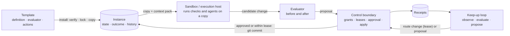

# StatePort architecture overview

This is the short map of the product. [ADR-0007](adr/0007-evaluator-loops-and-the-curve.md) records the model and the
scope decisions behind it; [the full architecture](ARCHITECTURE.md) defines ownership and trust boundaries in detail.

## The model in one line

An application is **state** (an instance repository the owner keeps), an **outcome** (what the work is for), an
**evaluator** (a deterministic check of the state), **actions** (checks, and changes an agent proposes) and **grants**
(what may run and apply, with which model, budget and expiry). Models are instruments. They can be replaced, and the
evaluator judges whether a replacement is better.

## Ownership in one page

- **Template author** owns the reusable definition, including the evaluator and the action instructions. A template asks
  for capabilities and never grants itself any. Its code runs only inside the sandbox.
- **Instance owner** owns the state, the outcome, the decisions and the grants. Chat history, context packs, caches and
  host sessions are not canonical; the conversation log and receipts are part of the durable record.
- **StatePort** owns lifecycle (resolve, verify, lock, copy), effective authority, leases, approvals, applying
  proposals, receipts, and the keep-up loop's instrument suites.
- **Instruments** (a model inside an agent harness such as OpenCode) work on a copy of the state and return a candidate.
  They never apply their own result, never see the control interface, and never judge their own work.

Effective authority = template request ∩ instance grant ∩ operator policy ∩ host capability ∩ run lease.

## Improvement loops

| Level | Changes | Judged by | Applies |
|---|---|---|---|
| Instruments | model route per kind of action | frozen task suite, deterministic grading, must beat the incumbent | automatically inside a lease, else a proposal |
| Definition | template releases, action instructions | the instance's evaluator before and after | proposal |
| Platform | StatePort | clean-machine primary journey | signed additive successor, owner accepts |

No loop changes its own evaluator, its held-out tasks or its authority.

## Current delivery boundary

This map describes the architecture. What a published release has been measured to do is stated on the public
[release page](https://lennertvhoy.github.io/StatePort-Site/releases/) and in `STATE.yaml`, not here. The supported
target is one local user on Windows 11 + WSL2 + Ubuntu 24.04 AMD64.
